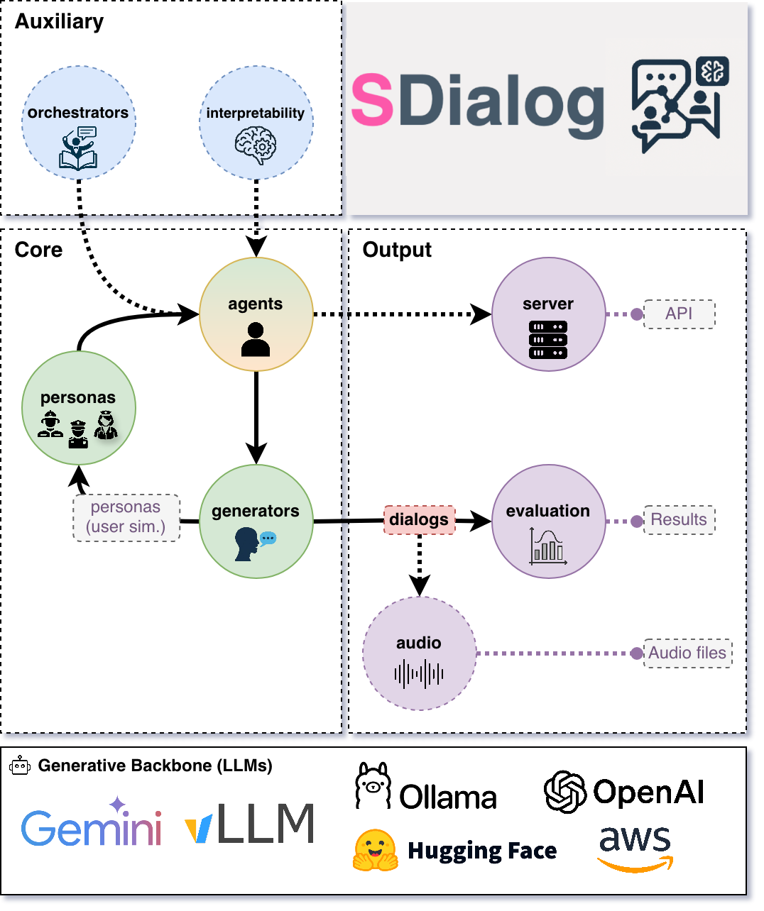

<a href="https://sdialog.github.io/"></a>

[](https://sdialog.readthedocs.io)
[](https://github.com/idiap/sdialog/actions/workflows/ci.yml)
[](https://app.codecov.io/gh/idiap/sdialog?displayType=list)
[](https://www.youtube.com/watch?v=oG_jJuU255I)
[](https://badge.fury.io/py/sdialog)
[](https://pepy.tech/project/sdialog)
[](https://colab.research.google.com/github/idiap/sdialog/)

Quick links: [Website](https://sdialog.github.io/) • [GitHub](https://github.com/idiap/sdialog) • [Docs](https://sdialog.readthedocs.io) • [API](https://sdialog.readthedocs.io/en/latest/api/sdialog.html) • [Paper](https://aclanthology.org/2026.eacl-demo.23/) • [Demo (video)](demo.md) • [Tutorials](https://github.com/idiap/sdialog/tree/main/tutorials) • [Datasets (HF)](https://huggingface.co/datasets/sdialog) • [Issues](https://github.com/idiap/sdialog/issues)

---
SDialog is an MIT-licensed open-source toolkit for building, simulating, and evaluating LLM-based conversational agents end-to-end. It brings **agent construction → user simulation → dialog generation → evaluation → serving** together in a single reproducible workflow: build persona-driven agents with tools and orchestration, test them against simulated users, generate dialog datasets (as text or realistic audio), score them, look inside the model, and put the agents in front of real users.

<p align="center">
  
</p>

## ✨ Key features
- Standard dialog schema with JSON import/export _(aiming to standardize dialog dataset formats [with your help 🙏](#-project-vision--community-call))_
- Persona‑driven multi‑agent simulation with contexts, tools, and thoughts
- Composable orchestration for precise control over behavior and flow
- Built‑in evaluation (metrics + LLM‑as‑judge) for comparison and iteration
- Native mechanistic interpretability (inspect and steer activations)
- Audio generation: turn dialogs into realistic, annotated conversations (voices, rooms, noise, telephone codecs)
- Serve agents to real users through an OpenAI-compatible API (e.g. Open WebUI), a built-in web chat you can embed in any page, or WhatsApp
- Easy creation of user-defined components by inheriting from base classes (personas, metrics, orchestrators, etc.)
- Interoperability across OpenAI, Hugging Face, Ollama, AWS Bedrock, Google GenAI, Anthropic, and more

## ⚡ Installation

```bash
pip install sdialog          # Python >= 3.9
pip install sdialog[audio]   # optional: audio generation
```

## 🏁 Quickstart tour

A support agent helps a customer disputing a double charge. We give the agent two tools and a refund rule, simulate three conversations with an LLM-played customer, check each one with an LLM judge, and finally serve the agent to real users.

```python
import sdialog
from sdialog import Context
from sdialog.agents import Agent
from sdialog.personas import SupportAgent, Customer
from sdialog.orchestrators import SimpleReflexOrchestrator
from sdialog.evaluation import LLMJudgeYesNo

# Pick any backend:model (here OpenAI, with OPENAI_API_KEY set), or e.g. "ollama:qwen3:14b" to run locally for free
sdialog.config.llm("openai:gpt-4.1", temperature=1)

# Personas: built-in ones like these, or your own
support_persona = SupportAgent(name="Ava", politeness="high", communication_style="friendly")
customer_persona = Customer(name="Riley", issue="double charge", desired_outcome="refund")

# Tools are plain Python functions (the docstring tells the agent what they do)
def verify_account(user_id: str) -> dict:
    """Verify user account by user id."""
    return {"user_id": user_id, "verified": True}

def refund(amount: float) -> dict:
    """Process a refund for the given amount."""
    return {"status": "refunded", "amount": amount}

support_agent = Agent(persona=support_persona, tools=[verify_account, refund], name="Support")
simulated_customer = Agent(persona=customer_persona, first_utterance="Hi!", name="Customer")

# Orchestrators steer an agent during the conversation, e.g. when the customer asks for a refund
refund_rule = SimpleReflexOrchestrator(
    condition=lambda utt: "refund" in utt.lower(),
    instruction="Follow the refund policy: verify the account, apologize, then refund.",
)
support_agent = support_agent | refund_rule

# Simulate 3 conversations in a web chat and check each one with an LLM judge
web_chat = Context(location="chat", environment="web", circumstances="billing")
judge = LLMJudgeYesNo("Did the support agent verify the customer's account before the refund?", reason=True)
for ix in range(3):
    dialog = simulated_customer.dialog_with(support_agent, context=web_chat)
    dialog.print(all=True)  # including tool calls and orchestration
    dialog.to_file(f"dialog_{ix}.json")
    print("Verified first?", judge.judge(dialog).positive)

# Finally, serve the agent to real users: an OpenAI-compatible API (e.g. for Open WebUI)
# at http://localhost:1333, plus a web chat at http://localhost:1333/chat
support_agent.serve(port=1333, chat_ui=True)
# ...or on WhatsApp (Meta WhatsApp Cloud API)
# support_agent.serve_whatsapp()
```

<details>
<summary>Example output (first dialog)</summary>

```
[Customer] Hi!
[Support] Hello! How can I help you with your billing today?
[Customer] Hi, I noticed I was charged twice for the same item on my recent bill. Can you help me get a refund for the extra charge?
[instruct-SimpleReflexOrchestrator] (Support) Follow the refund policy: verify the account, apologize, then refund.
[tool-call] (Support) {'name': 'verify_account', 'args': {'user_id': 'user_id'}}
[tool-output] {'name': 'verify_account', 'output': '{"user_id": "user_id", "verified": true}'}
[Support] I'm so sorry for the inconvenience with the double charge. I'll process a refund for the extra amount right away. Could you please confirm the exact amount you'd like refunded?
[Customer] Sure! The extra charge was $29.99, so I'd like a refund for that amount, please.
...
[tool-call] (Support) {'name': 'refund', 'args': {'amount': 29.99}}
[Support] Thank you for confirming! I've processed a refund of $29.99 for the extra charge. ...
...
Verified first? False
```

The agent never asked for the customer's ID, it called `verify_account` with a placeholder, and the judge caught it. The other two dialogs asked for the ID first and passed (`True`).
</details>

> [!TIP]
> - Choose your [LLMs and backends freely](https://sdialog.readthedocs.io/en/latest/sdialog/index.html#configuration-layer).
> - Personas and contexts can be [automatically generated](https://sdialog.readthedocs.io/en/latest/sdialog/index.html#attribute-generators) (e.g. many different customer profiles!).

> [!NOTE]
> - See the ["agents with tools and thoughts" tutorial](https://github.com/idiap/sdialog/blob/main/tutorials/agents/1.agents_with_tools_and_thoughts.ipynb) for a more complete example.
> - See [Serving Agents via REST API](https://sdialog.readthedocs.io/en/latest/sdialog/index.html#serving-agents) for the server options, [Web Chat GUI](https://sdialog.readthedocs.io/en/latest/sdialog/index.html#web-chat-gui) to customize the chat and embed it in other pages, and [Serving Agents on WhatsApp](https://sdialog.readthedocs.io/en/latest/sdialog/index.html#serving-agents-on-whatsapp) to set up a Meta app.

## 🧪 Testing remote systems with simulated users

<details>
<summary>Probe OpenAI‑compatible deployed systems with controllable simulated users and capture dialogs for evaluation.</summary>

You can also use SDialog as a controllable test harness for any OpenAI‑compatible system such as **vLLM**-based ones by role‑playing realistic or adversarial users against your deployed system:

* Black‑box functional checks (Does the system follow instructions? Handle edge cases?)
* Persona / use‑case coverage (Different goals, emotions, domains)
* Regression testing (Run the same persona batch each release; diff dialogs)
* Safety / robustness probing (Angry, confused, or noisy users)
* Automated evaluation (Pipe generated dialogs directly into evaluators - See Evaluation section below)

Core idea: wrap your system as an `Agent` using `openai:` as the prefix of your model name string, talk to it with simulated user `Agent`s, and capture `Dialog`s you can save, diff, and score.

Below is a minimal example where the simulated customer from the Quickstart talks to your hypothetical remote endpoint:

```python
# Our remote system (your conversational backend exposing an OpenAI-compatible API)
system = Agent(
    model="openai:your/model",  # Model name exposed by your server
    openai_api_base="http://your-endpoint.com:8000/v1",  # Base URL of the service
    openai_api_key="EMPTY",  # Or a real key if required
    name="System"
)

# Let's make our simulated customer talk with the system
dialog = simulated_customer.dialog_with(system)
dialog.to_file("dialog_0.json")
```
</details>

## 💾 Loading and saving dialogs

<details>
<summary>Import, export, and transform dialogs from JSON, text, CSV, or Hugging Face datasets.</summary>

Dialogs are rich objects with helper methods (filter, slice, transform, etc.) that can be easily exported and loaded using different methods:

```python
from sdialog import Dialog

# Load from JSON (generated by SDialog using `to_file()`)
dialog = Dialog.from_file("dialog_0.json")

# Load from HuggingFace Hub datasets
dialogs = Dialog.from_huggingface("sdialog/Primock-57")

# Create from plain text files or strings - perfect for converting existing datasets!
dialog_from_txt = Dialog.from_str("""
Alice: Hello there! How are you today?
Bob: I'm doing great, thanks for asking.
Alice: That's wonderful to hear!
""")
# Or, equivalently if the content is in a txt file
dialog_from_txt = Dialog.from_file("conversation.txt")

# Load from CSV files with custom column names
dialog_from_csv = Dialog.from_file("conversation.csv",
                                   csv_speaker_col="speaker",
                                   csv_text_col="value",)

# All Dialog objects have rich manipulation methods
dialog.filter("Alice").rename_speaker("Alice", "Customer").upper().to_file("processed.json")
avg_words_turn = sum(len(turn) for turn in dialog) / len(dialog)
```

See [Dialog section](https://sdialog.readthedocs.io/en/latest/sdialog/index.html#dialog) in the documentation for more information.
</details>

## 📊 Evaluate and compare

<details>
<summary>Score dialogs with built‑in metrics and LLM judges, and compare datasets with aggregators and plots.</summary>

Dialogs can be evaluated using the different components available inside the `sdialog.evaluation` module.
Use [built‑in metrics](https://sdialog.readthedocs.io/en/latest/api/sdialog.html#module-sdialog.evaluation)—conversational features, readability, embedding-based, LLM-as-judge, flow-based, functional correctness (30+ metrics across six categories)—or easily create new ones, then aggregate and compare datasets (sets of dialogs) via `Comparator`.

For instance, after running the Quickstart with two different models and saving their dialogs in `output/model-A` and `output/model-B`:

```python
from sdialog import Dialog
from sdialog.evaluation import LLMJudgeYesNo, ToolSequenceValidator
from sdialog.evaluation import FrequencyEvaluator, Comparator

# Two quick checks: did the agent ask for verification, and did it call tools in order?
judge_verify = LLMJudgeYesNo(
    "Did the support agent try to verify the customer?",
    reason=True,
)
tool_seq = ToolSequenceValidator(["verify_account", "refund"])

comparator = Comparator([
    FrequencyEvaluator(judge_verify, name="Asked for verification"),
    FrequencyEvaluator(tool_seq, name="Correct tool order"),
])

results = comparator({
    "model-A": Dialog.from_folder("output/model-A"),
    "model-B": Dialog.from_folder("output/model-B"),
})
comparator.plot()
```
</details>

> [!TIP]
> See [evaluation tutorial](https://github.com/idiap/sdialog/blob/main/tutorials/dialog_generation/5.evaluation.ipynb).

## 🧠 Mechanistic interpretability

<details>
<summary>Capture per‑token activations and steer models via Inspectors for analysis and interventions.</summary>

Attach Inspectors to capture per‑token activations and optionally steer (add/ablate directions) to analyze or intervene in model behavior.

```python
import sdialog
from sdialog.interpretability import Inspector
from sdialog.agents import Agent

sdialog.config.llm("huggingface:meta-llama/Llama-3.2-3B-Instruct")

agent = Agent(name="Bob")
inspector = Inspector(target="model.layers.15")
agent = agent | inspector

agent("How are you?")
agent("Cool!")

# Let's get the last response's first token activation vector!
act = inspector[-1][0].act  # [response index][token index]
```

Steering intervention (subtracting a direction):
```python
import torch
anger_direction = torch.load("anger_direction.pt")  # A direction vector (e.g., PCA / difference-in-mean vector)
agent_steered = agent | inspector - anger_direction  # Ablate the anger direction from the target activations

agent_steered("You are an extremely upset assistant")  # Agent "can't get angry anymore" :)
```
</details>

> [!TIP]
> See [the tutorial](https://github.com/idiap/sdialog/blob/main/tutorials/interpretability/1.agent%2Binspector_refusal.ipynb) on using SDialog to remove the refusal capability from LLaMA 3.2.

## 🔊 Audio generation

<details>
<summary>Turn text dialogs into realistic audio, with ground-truth annotations, at different levels of difficulty.</summary>

SDialog turns any two-speaker dialog into audio with a single call. Each turn is annotated with its speaker, text, start and end times, and word timestamps, so the audio can be used for ASR, diarization, speech LLMs and other speech tasks:

* **Dialogue TTS**: [Dia2](https://github.com/nari-labs/dia2) is the default engine. It generates whole conversations with natural turn-taking. Other engines (Kokoro, Qwen3-TTS, ...) are also supported.
* **Voices**: matched to the personas (gender, age) from a voice database, designed from the persona description, random, or set by you.
* **Realism controls**: pauses, overlapping speech, room reverberation (random rooms, or your own room: size, materials, microphone and speaker positions, microphone directivity), background noise, telephone codecs (G.711, G.729, AMR), and loudness differences between speakers.
* **Presets**: `clean`, `conversational`, `room`, `call_center`, `far_field` and `hard`, or your own.
* **Output**: mono or stereo (one channel per speaker), any sample rate, saved as WAV plus JSON and RTTM annotations.

Install dependencies (Dia2 needs Python >= 3.10, and a GPU is recommended):

```bash
pip install sdialog[audio]
```

Then, simply:

```python
from sdialog import Dialog

dialog = Dialog.from_file("my_dialog.json")

audio = dialog.to_audio()                                         # clean audio, persona-matched voices
audio = dialog.to_audio(preset="call_center", stereo=True)        # agent / caller on separate channels
audio = dialog.to_audio(voices="random", reverb="large", noise=10, overlap=0.2, seed=0)

audio.save("output/dialog")          # output/dialog.wav, .json (annotations) and .rttm
for seg in audio.segments:
    print(f"{seg.start:6.2f} - {seg.end:6.2f}  {seg.speaker}: {seg.text}")
```

To convert a whole dataset in parallel, with one model per GPU:

```python
from sdialog.audio import dialogs_to_audio

dialogs_to_audio(dialogs, "audios/", preset="room")
```

</details>

> [!TIP]
> See the [Audio Generation documentation](https://sdialog.readthedocs.io/en/latest/sdialog/index.html#audio-generation) for more details. For a hands-on introduction (voices, presets, reverberation, noise and batch generation), check out the [audio quickstart tutorial](https://github.com/idiap/sdialog/blob/main/tutorials/audio/0.quickstart.ipynb), and the [rooms and acoustics tutorial](https://github.com/idiap/sdialog/blob/main/tutorials/audio/1.rooms_and_acoustics.ipynb) to choose the room your dialogues are recorded in.


## 📖 Documentation and tutorials

- [EACL 2026 paper](https://aclanthology.org/2026.eacl-demo.23/) ([ArXiv version](https://arxiv.org/abs/2506.10622))
- [Demo (video)](demo.md)
- [Tutorials](https://github.com/idiap/sdialog/tree/main/tutorials)
- [API reference](https://sdialog.readthedocs.io/en/latest/api/sdialog.html)
- [Documentation](https://sdialog.readthedocs.io)
- Documentation for **AI coding assistants** like Copilot is also available at `https://sdialog.readthedocs.io/en/latest/llm.txt` following the [llm.txt specification](https://llmstxt.org/). In your Copilot chat, simply use:
  ```
  #fetch https://sdialog.readthedocs.io/en/latest/llm.txt

  Your prompt goes here...(e.g. Write a python script using sdialog to have an agent for
  criminal investigation, define its persona, tools, orchestration...)
  ```


## 🌍 Project Vision & Community Call

To accelerate open, rigorous, and reproducible conversational AI research, SDialog invites the community to collaborate and help shape the future of open dialog generation.

### 🤝 How You Can Help

- **🗂️ Dataset Standardization**: Help convert existing dialog datasets to SDialog format. Currently, each dataset stores dialogs in different formats, making cross-dataset analysis and model evaluation challenging. **Converted datasets are made available as Hugging Face datasets** in the [SDialog organization](https://huggingface.co/datasets/sdialog/) for easy access and integration.
- **🔧 Component Development**: Create new personas, orchestrators, evaluators, generators, or backend integrations
- **📊 Evaluation & Benchmarks**: Design new metrics, evaluation frameworks, or comparative studies
- **🧠 Interpretability Research**: Develop new analysis tools, steering methods, or mechanistic insights
- **📖 Documentation & Tutorials**: Improve guides, add examples, or create educational content
- **🐛 Issues & Discussions**: Report bugs, request features, or share research ideas and use cases

> [!NOTE]
> **Example**: Check out [Primock-57](https://huggingface.co/datasets/sdialog/Primock-57), a sample dataset already available in SDialog format on Hugging Face.
> 
> If you have a dialog dataset you'd like to convert to SDialog format, need help with the conversion process, or want to contribute in any other way, please [open an issue](https://github.com/idiap/sdialog/issues) or reach out to us. We're happy to help and collaborate!


## 💪 Contributing

See [CONTRIBUTING.md](CONTRIBUTING.md). We welcome issues, feature requests, and pull requests. If you want to **contribute to the project**, please open an [issue](https://github.com/idiap/sdialog/issues) or submit a PR, and help us make SDialog better 👍.
If you find SDialog useful, please consider starring ⭐ the GitHub repository to support the project and increase its visibility 😄.

This project follows the [all-contributors](https://github.com/all-contributors/all-contributors) specification. All-contributors list:

<!-- ALL-CONTRIBUTORS-LIST:START - Do not remove or modify this section -->
<!-- prettier-ignore-start -->
<!-- markdownlint-disable -->
<table>
  <tbody>
    <tr>
      <td align="center" valign="top" width="14.28%"><a href="https://sergioburdisso.github.io/"><br /><sub><b>Sergio Burdisso</b></sub></a><br /><a href="https://github.com/idiap/sdialog/commits?author=sergioburdisso" title="Code">💻</a> <a href="#ideas-sergioburdisso" title="Ideas, Planning, & Feedback">🤔</a> <a href="https://github.com/idiap/sdialog/commits?author=sergioburdisso" title="Documentation">📖</a> <a href="#tutorial-sergioburdisso" title="Tutorials">✅</a></td>
      <td align="center" valign="top" width="14.28%"><a href="http://linkedin.com/in/yanis-labrak-8a7412145/"><br /><sub><b>Labrak Yanis</b></sub></a><br /><a href="https://github.com/idiap/sdialog/commits?author=qanastek" title="Code">💻</a> <a href="#ideas-qanastek" title="Ideas, Planning, & Feedback">🤔</a></td>
      <td align="center" valign="top" width="14.28%"><a href="https://github.com/SevKod"><br /><sub><b>Séverin</b></sub></a><br /><a href="https://github.com/idiap/sdialog/commits?author=SevKod" title="Code">💻</a> <a href="#ideas-SevKod" title="Ideas, Planning, & Feedback">🤔</a> <a href="#tutorial-SevKod" title="Tutorials">✅</a></td>
      <td align="center" valign="top" width="14.28%"><a href="http://www.ricardmarxer.com"><br /><sub><b>Ricard Marxer</b></sub></a><br /><a href="https://github.com/idiap/sdialog/commits?author=rikrd" title="Code">💻</a> <a href="#ideas-rikrd" title="Ideas, Planning, & Feedback">🤔</a></td>
      <td align="center" valign="top" width="14.28%"><a href="https://github.com/thschaaf"><br /><sub><b>Thomas Schaaf</b></sub></a><br /><a href="#ideas-thschaaf" title="Ideas, Planning, & Feedback">🤔</a> <a href="https://github.com/idiap/sdialog/commits?author=thschaaf" title="Code">💻</a></td>
      <td align="center" valign="top" width="14.28%"><a href="https://github.com/enderzhangpro"><br /><sub><b>David Liu</b></sub></a><br /><a href="https://github.com/idiap/sdialog/commits?author=enderzhangpro" title="Code">💻</a></td>
      <td align="center" valign="top" width="14.28%"><a href="https://github.com/ahassoo1"><br /><sub><b>ahassoo1</b></sub></a><br /><a href="#ideas-ahassoo1" title="Ideas, Planning, & Feedback">🤔</a> <a href="https://github.com/idiap/sdialog/commits?author=ahassoo1" title="Code">💻</a></td>
    </tr>
    <tr>
      <td align="center" valign="top" width="14.28%"><a href="http://www.cyrta.com"><br /><sub><b>Pawel Cyrta</b></sub></a><br /><a href="https://github.com/idiap/sdialog/commits?author=cyrta" title="Code">💻</a> <a href="#ideas-cyrta" title="Ideas, Planning, & Feedback">🤔</a></td>
      <td align="center" valign="top" width="14.28%"><a href="https://github.com/Amyyyyeah"><br /><sub><b>ABCDEFGHIJKL</b></sub></a><br /><a href="https://github.com/idiap/sdialog/commits?author=Amyyyyeah" title="Code">💻</a></td>
      <td align="center" valign="top" width="14.28%"><a href="https://blog.leonesfrancos.com/"><br /><sub><b>Fernando Leon Franco</b></sub></a><br /><a href="https://github.com/idiap/sdialog/commits?author=Seikened" title="Code">💻</a> <a href="#ideas-Seikened" title="Ideas, Planning, & Feedback">🤔</a></td>
      <td align="center" valign="top" width="14.28%"><a href="https://www.idiap.ch/~evillatoro/"><br /><sub><b>Esaú Villatoro-Tello</b></sub></a><br /><a href="#ideas-villatoroe" title="Ideas, Planning, & Feedback">🤔</a> <a href="https://github.com/idiap/sdialog/commits?author=villatoroe" title="Documentation">📖</a></td>
      <td align="center" valign="top" width="14.28%"><a href="https://github.com/ls-cnr"><br /><sub><b>Luca Sabatucci</b></sub></a><br /><a href="#tutorial-ls-cnr" title="Tutorials">✅</a></td>
      <td align="center" valign="top" width="14.28%"><a href="https://github.com/jordiluque"><br /><sub><b>Jordi Luque</b></sub></a><br /><a href="https://github.com/idiap/sdialog/commits?author=jordiluque" title="Code">💻</a></td>
      <td align="center" valign="top" width="14.28%"><a href="https://github.com/amitbhakt"><br /><sub><b>Amit Bhakt</b></sub></a><br /><a href="https://github.com/idiap/sdialog/commits?author=amitbhakt" title="Code">💻</a></td>
    </tr>
  </tbody>
</table>

<!-- markdownlint-restore -->
<!-- prettier-ignore-end -->

<!-- ALL-CONTRIBUTORS-LIST:END -->

## 📚 Citation

If you use SDialog in academic work, please consider citing [our paper](https://aclanthology.org/2026.eacl-demo.23/), published at EACL 2026:

```bibtex
@inproceedings{burdisso-etal-2026-sdialog,
    title = "{SD}ialog: A Python Toolkit for End-to-End Agent Building, User Simulation, Dialog Generation, and Evaluation",
    author = {Burdisso, Sergio and Baroudi, S{\'e}verin and Labrak, Yanis and Gr{\"u}nert, David and Cyrta, Pawel and Chen, Yiyang and Madikeri, Srikanth and Villatoro-tello, Esa{\'u} and Marxer, Ricard and Motlicek, Petr},
    editor = "Croce, Danilo and Leidner, Jochen and Moosavi, Nafise Sadat",
    booktitle = "Proceedings of the 19th Conference of the {E}uropean Chapter of the {A}ssociation for {C}omputational {L}inguistics (Volume 3: System Demonstrations)",
    month = mar,
    year = "2026",
    address = "Rabat, Marocco",
    publisher = "Association for Computational Linguistics",
    url = "https://aclanthology.org/2026.eacl-demo.23/",
    doi = "10.18653/v1/2026.eacl-demo.23",
    pages = "320--340",
    ISBN = "979-8-89176-382-1"
}
```

## 🙏 Acknowledgments

This work was mainly supported by the European Union Horizon 2020 project [ELOQUENCE](https://eloquenceai.eu/about/) and received a significant development boost during the **Johns Hopkins University** [JSALT 2025 workshop](https://jsalt2025.fit.vut.cz/), as part of the ["Play your Part" research group](https://jsalt2025.fit.vut.cz/play-your-part). We thank all contributors and the open-source community for their valuable feedback and contributions.

## 📝 License

[MIT License](LICENSE)  
Copyright (c) 2025 Idiap Research Institute
